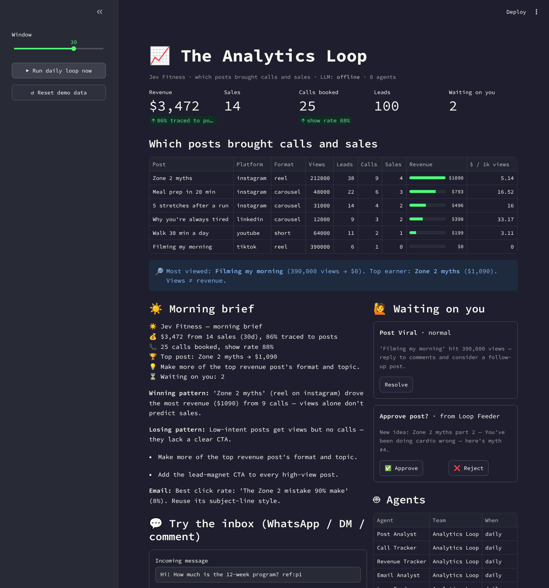
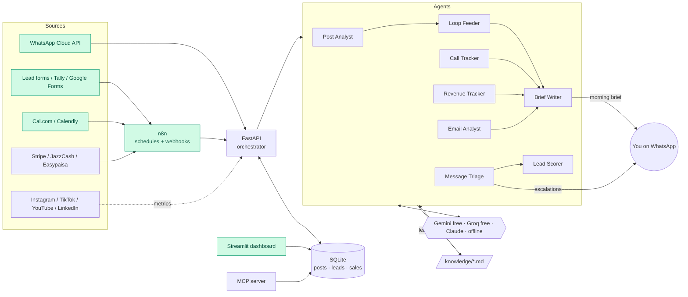

# 📈 AI Marketing Team: The Analytics Loop

**Which posts actually brought calls and sales?** Creators and coaches can't answer this.
Views live in Instagram/TikTok, calls in Cal.com/Calendly, payments in Stripe/JazzCash, and
nothing connects them. This project connects them with a team of AI agents, n8n automations
and WhatsApp alerts. **Every tool in the stack has a free tier.**



> Most viewed post: **390K views → $0**. Top earner: **212K views → $1,090**. Views ≠ revenue.

## What it does

| | |
|---|---|
| 🔗 **Attribution** | Every post gets a code (`p12`). It travels through link UTMs, click-to-WhatsApp messages and form fields, so each lead, call and sale is traced back to the post that caused it. |
| 🤖 **8 AI agents** | Post Analyst, Call Tracker, Revenue Tracker, Email Analyst, Loop Feeder, Brief Writer, Message Triage, Lead Scorer |
| 🔁 **The loop** | Analyse → write learnings to `knowledge/learnings.md` → queue next content ideas for approval. Tomorrow's content is based on what made money today. |
| 💬 **WhatsApp** | Customers message your WhatsApp. The agents classify the message, reply on-brand and score the lead. Angry customers or people asking for a human go to *you*. The morning brief also arrives on WhatsApp. |
| 🛑 **Guardrails in code** | Angry message, wants a human, risky health claim, viral post, hot lead, unsubscribe, budget low → escalation + WhatsApp ping. A prompt can be ignored by the model; these checks are code, so they always run. |
| ⚙️ **n8n** | Daily 07:00 loop, lead capture, Cal.com bookings, JazzCash/Easypaisa/manual payments |
| 🧩 **MCP server** | Ask Claude Desktop / Cursor *"which post made the most money?"* |

## Architecture



**Design rule:** *numbers come from SQL, judgement comes from the LLM.* The model never does
arithmetic on revenue. It gets computed facts and writes insights, scores and replies. Every
agent has an offline fallback, so a rate-limited free tier slows the system down instead of
breaking it.

## Quick start (2 minutes, no keys needed)

```bash
pip install -r requirements.txt
python -m marketing_team seed          # demo data
python -m marketing_team attribution   # which posts brought calls and sales
python -m marketing_team run           # run the daily loop → morning brief
python -m marketing_team message "how much is coaching? ref:p1" --channel whatsapp
streamlit run dashboard.py             # dashboard at http://localhost:8501
uvicorn marketing_team.server:app      # API at http://localhost:8000/docs
pytest -q                              # 8 tests
```

Add a free **Gemini** key (`GOOGLE_API_KEY`, from aistudio.google.com) or **Groq** key
(`GROQ_API_KEY`) to `.env` and the agents switch from templates to real LLM reasoning.
`MT_LLM_PROVIDER=claude` uses Claude.

## Full stack with Docker (API + dashboard + n8n)

```bash
cp .env.example .env     # fill in what you have
docker compose up -d
```
- n8n → http://localhost:5678 → *Import from file* → each file in [`n8n/`](n8n) → activate
- Webhook URLs n8n gives you: `/webhook/lead`, `/webhook/calcom`, `/webhook/payment`

## WhatsApp setup (free)

1. developers.facebook.com → **Create app** → *Business* → add **WhatsApp**.
2. *API Setup* gives you a free test number, a temporary token and a **Phone number ID**.
   Add your own number as a recipient. Put the values in `.env`: `WHATSAPP_TOKEN`,
   `WHATSAPP_PHONE_NUMBER_ID`, `WHATSAPP_OWNER_NUMBER=923001234567`.
3. Expose the API (`cloudflared tunnel --url http://localhost:8000` or `ngrok http 8000`, both free).
4. *Configuration → Webhook*: callback `https://<your-tunnel>/webhooks/whatsapp`, verify token =
   `WHATSAPP_VERIFY_TOKEN`, subscribe to **messages**.
5. Message your test number. The agents reply, score the lead and ping you if needed.

> WhatsApp only delivers free-form messages within 24h of the person last messaging you.
> Send "hi" to your bot number to open the window for the morning brief.
> For production, create an approved message template.

**Attribution on WhatsApp:** put click-to-WhatsApp links in post captions/bios:
`https://wa.me/923001234567?text=Hi!%20ref:p12`. The `ref:p12` ties the conversation to post 12.

## Deploy for free (to share a live demo link)

| Piece | Free option |
|---|---|
| Dashboard | **Streamlit Community Cloud** → main file `dashboard.py` (seeds demo data on first run) |
| API | Render / Railway / Fly.io free tier, or Oracle Cloud Always-Free VM with Docker |
| n8n | Self-host in the same docker-compose (Oracle free VM), or n8n Cloud trial |
| LLM | Gemini free tier / Groq free tier |

## Project layout

```
marketing_team/
  agents.py         8 agents (SQL facts → LLM judgement → offline fallback)
  orchestrator.py   daily loop, event routing, attribution, webhook parsers
  guardrails.py     "what interrupts the loop", enforced in code
  llm.py            Gemini / Groq / Claude / offline behind one interface + budget
  integrations.py   WhatsApp, Telegram, Slack, Stripe + mocks
  db.py             schema + attribution SQL
  server.py         FastAPI (events, vendor webhooks, approvals)
  mcp_server.py     MCP tools for Claude Desktop / Cursor
  knowledge/        voice · offer · audience · content · channels · rules · compliance · reporting · learnings
n8n/                importable workflows
dashboard.py        Streamlit UI
tests/              pytest
app.py, main.py     (original multi-LLM chat: Claude + GPT + Gemini + Llama)
```

## Roadmap
- Real post metrics: Instagram Graph API / TikTok Display API (read-only)
- Content department: Post Writer + Approval Desk publishing through Buffer
- Multi-tenant SaaS: Postgres (Supabase free), auth, one workspace per creator

MIT License
